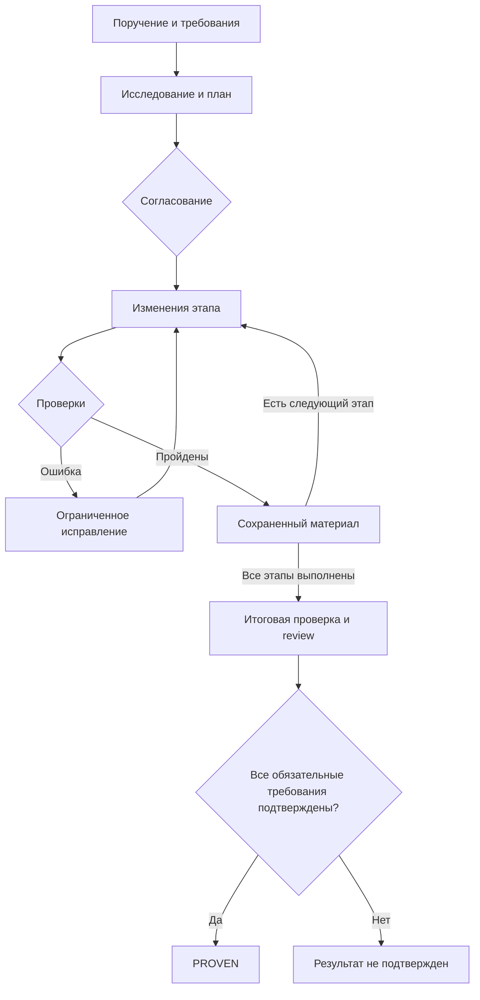

<div align="center">


# Flowcairn

### AI выполняет задачу. Вы видите план, проверки и свой код.

Локальный инструмент для разработки с AI: превращает поручение в согласованный план,
выполняет работу с учетом зависимостей и показывает, чем подтвержден результат.

[](https://www.npmjs.com/package/flowcairn)
[](https://github.com/IgorBabikov/Flowcairn/actions/workflows/ci.yml)
[](LICENSE)

**[Открыть интерактивную демо](https://igorbabikov.github.io/Flowcairn/)** · [Видео](https://igorbabikov.github.io/Flowcairn/#recording) · [Быстрый старт](#быстрый-старт) · [Документация](docs/README.md)

<a href="https://igorbabikov.github.io/Flowcairn/">
<picture>
  <source media="(prefers-reduced-motion: reduce)" srcset="https://raw.githubusercontent.com/IgorBabikov/Flowcairn/main/docs/demo/media/work.jpg" />
  
</picture>
</a>

</div>

**Это запись работающего интерфейса.** Ответы AI подставные; Executor, изменение файла, процессы проверок и отчеты настоящие. GIF показывает шесть кадров, [полное видео и данные запуска](https://igorbabikov.github.io/Flowcairn/) доступны в демо. Это не демонстрация live inference.

## От поручения до проверенного результата

AI написал код — но что он изменил, почему считает работу законченной и сможете ли вы разобраться в решении завтра? Flowcairn связывает эти вопросы в один процесс:

1. **Опишите результат.** Система исследует проект, выделяет требования и неизвестные.
2. **Проверьте план.** Видны работы, зависимости, область записи и способы проверки. Изменения начинаются после согласования.
3. **Следите за выполнением.** Герои Мастерской отражают реальные состояния узлов. Ошибка проверки вызывает ограниченное исправление или останавливает работу.
4. **Посмотрите доказательства.** Для каждого обязательного требования нужны допустимая проверка и актуальные данные. Зеленый узел или общий ответ AI сами по себе недостаточны.
5. **Разберите свой код.** В книге сохранены исходники, версии и контекст. Объяснение доступно по возможностям выбранного AI-клиента.

## Попробуйте разобраться сами

В [интерактивной записи](https://igorbabikov.github.io/Flowcairn/) можно выбирать моменты, открывать узлы плана и исследовать зависимости, статусы, хеши и идентификаторы отчетов. Установка и AI-аккаунт не нужны.

| В записи | Что действительно произошло |
| --- | --- |
| [План](https://igorbabikov.github.io/Flowcairn/#plan) | До согласования `counter.json` содержит `0` |
| [Ошибка](https://igorbabikov.github.io/Flowcairn/#repair) | Первая правка записала `1`; проверка ожидала `2` и завершилась с exit 1 |
| [Результат](https://igorbabikov.github.io/Flowcairn/#result) | Исправление записало `2`; проверка прошла, Executor рассчитал `PROVEN` после подставного review |
| [Устаревание](https://igorbabikov.github.io/Flowcairn/#stale) | Внешнее изменение на `3` сняло подтверждение текущего результата |

### Где здесь граф

План — направленный граф: узел знает свои зависимости (`needs`), разрешенную работу и проверки. Executor управляет переходами и не пропускает обязательные проверки. Главный интерфейс — 2D-мир; технические подробности доступны в книге диагностики. Это не редактор ReactFlow.



Схема упрощает внутренний граф. Учебная пауза зависит от режима; отсутствие проверки, неопределенность и устаревшие данные не становятся PASS. [Подробный контракт](docs/HOW-FLOWCAIRN-WORKS.md).

## Код остается понятным и доступным

<a href="https://igorbabikov.github.io/Flowcairn/#code"></a>

Сохраненные версии показывают, что было до и после работы. Разбор можно выбрать после этапа или после всей задачи. Чтение, ответы и отметки прогресса не доказывают понимание и не меняют `PROVEN`. Продолжение после учебной паузы — отдельная команда.

## Быстрый старт

В корне своего проекта, с **Node.js 22**:

```sh
npx flowcairn
```

Пройдите короткую настройку, авторизуйте выбранный AI-клиент и откройте Гильдию. Опишите задачу, проверьте план и разрешения, затем начните выполнение. Git и `package.json` не обязательны для direct-запуска.

Если браузер нужно открыть вручную:

```sh
npx flowcairn --no-open
```

[Установка](docs/INSTALLATION.md) · [Первая задача](docs/FIRST-TASK.md) · [Проверки других языков](docs/CHECK-PROFILES.md) · [Решение проблем](docs/TROUBLESHOOTING.md)

## Клиенты и текущие ограничения

- **Codex, Claude Code, Cursor** подключаются через официальные CLI и их авторизацию. Codex и Claude Code поставляются с проверенными базовыми версиями; Cursor Agent CLI устанавливается отдельно.
- Целевые ОС — **macOS и native Windows**; Linux/WSL исключены. Локальная проверка macOS не подтверждает Windows. Актуальные прогоны и границы — в [VERIFICATION](docs/VERIFICATION.md).
- Claude Code и Cursor проверялись через native-no-inference и симуляторы без авторизованных аккаунтов. Это не live inference. Учебная генерация имеет отдельные ограничения по клиентам, версиям и ОС.
- Проверки запускаются локально с правами пользователя. Flowcairn не добавляет универсальную файловую песочницу и не заменяет permission controls AI-клиента.
- Эффективность обучения и производительность на целевом оборудовании требуют отдельной приемки. [Все ограничения](docs/LIMITATIONS.md).

## Документация и участие

[Как работает](docs/HOW-FLOWCAIRN-WORKS.md) · [Архитектура](docs/ARCHITECTURE.md) · [AI-клиенты](docs/AI-HARNESS-INTEGRATION.md) · [Skills](docs/SKILLS.md) · [Участие](CONTRIBUTING.md) · [Безопасность](SECURITY.md)

Для разработки:

```sh
npm ci --ignore-scripts
npm test
npm run build
npm run test:ui
```

[Происхождение медиа](.github/media/README.md) · [Исследование оформления](docs/README-VISUAL-RESEARCH.md) · [Перезапись демо](docs/demo/README.md).
Лицензия [MIT](LICENSE). [Сторонние материалы и лицензии](THIRD_PARTY_NOTICES.md).
